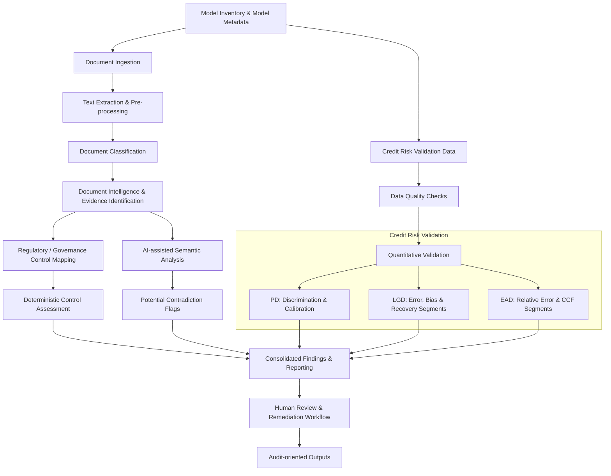

<div align="center">

# 🛡️ ModelGuard AI

### AI-Powered Model Risk Management, Regulatory Governance & Credit Risk Validation

**Bringing document intelligence, regulatory traceability and quantitative credit risk analytics into one modular framework.**


</div>

---

## 🔎 At a glance

ModelGuard AI is a research and portfolio prototype exploring how artificial intelligence, machine learning and quantitative analytics can support **Model Risk Management (MRM)** activities in financial institutions.

The framework brings together:

- **Model governance:** model inventory, documentation categories and control-oriented assessment.
- **Document intelligence:** text processing, document classification and evidence-oriented analysis.
- **AI-assisted review:** semantic analysis and potential contradiction identification.
- **Quantitative validation:** performance and calibration analysis for **Probability of Default (PD)**, **Loss Given Default (LGD)** and **Exposure at Default (EAD)**.
- **Governance outputs:** structured validation tests, potential findings, remediation prompts and review statuses.

> **Design principle:** AI assists analysis; it does not replace independent validation, accountable human judgement, regulatory interpretation or formal model approval.

## 🎯 The problem this project explores

Model risk teams work with large volumes of model documentation, governance records, validation evidence and quantitative performance information. These materials can be fragmented across documents and processes.

ModelGuard AI explores a modular workflow for organizing this information, surfacing evidence for review, applying transparent rules and bringing selected quantitative validation measures into a consolidated reporting process.

It is intended as a demonstrator of a possible workflow—not as a claim that the challenges of bank-wide MRM can be solved by a single automated system.

---

## 🧭 Architecture

The architecture separates source data, document intelligence, deterministic assessment, AI-assisted analysis, quantitative validation and human governance.



### Architecture boundaries

| Layer | Responsibility | Output |
|---|---|---|
| Inventory and ingestion | Organize model metadata and source documents | Model/document records |
| Document intelligence | Process text and classify document types | Predicted document categories |
| Evidence analysis | Identify candidate evidence and potential inconsistencies | Reviewable evidence candidates |
| Control assessment | Apply configured deterministic checks | Control assessment results |
| Quantitative validation | Evaluate PD, LGD and EAD metrics | Metrics, segments and test results |
| Governance reporting | Consolidate potential findings | CSV/JSON reports for review |
| Human oversight | Review, challenge, approve or remediate | Accountable governance decisions |

---

## 🧩 Core capabilities

### 1. Model inventory and documentation

Organizes model records and associates documentation with model governance activities. The document categories represented in the prototype include:

- Model Development Document
- Model Validation Report
- Model Monitoring Report
- Model Governance Policy
- Model Approval Document
- Model Change Request
- Data Quality Assessment Report
- Issue Remediation Register

### 2. Machine learning document classification

The document-classification workbench explores:

- TF-IDF text representation.
- Logistic Regression as a baseline classifier.
- A PyTorch multilayer perceptron classifier.
- Model-level grouped train/validation/test splitting to reduce leakage between documents belonging to the same model.
- Model comparison and prediction outputs.

### 3. AI-assisted document analysis

A Natural Language Inference (NLI) workflow is used to flag candidate contradictions for further investigation.

These outputs are **signals for human review**, not proof that a document is incorrect or that a control has failed. Model performance must be interpreted in light of the synthetic and template-based nature of the prototype corpus.

### 4. Governance and control assessment

The project includes a structured approach to connecting documentation and governance checks with regulatory and supervisory themes.

Potential reference areas include:

- Federal Reserve model risk management guidance.
- European Central Bank internal model expectations.
- Basel Framework.
- European Banking Authority guidance relevant to PD and LGD.
- Reserve Bank of India supervisory expectations.
- IFRS 9 impairment requirements.

These sources do not have identical legal status or scope. Any real-world implementation must record the authoritative source, jurisdiction, paragraph or section, effective date, applicability rationale and approved interpretation. IFRS 9 is an accounting standard, not a general supervisory MRM rulebook.

### 5. Quantitative credit risk validation

The Phase 6 prototype generates synthetic datasets and demonstrates selected validation techniques.

| Risk component | Illustrative analyses |
|---|---|
| **PD** | ROC-AUC, Gini, KS discrimination statistic, Brier score, log loss, observed-to-expected ratio, calibration by decile and chronological out-of-time assessment |
| **LGD** | MAE, RMSE, prediction bias, exposure-weighted errors and collateral-segment analysis |
| **EAD** | MAE, RMSE, relative errors, CCF analysis, CCF bias and utilisation-segment analysis |

The PD dataset includes TTC and PIT PD fields, while the Phase 6 quantitative evaluation focuses on PIT PD against generated default outcomes. LGD and EAD analyses use synthetic cross-sectional samples; they should not be described as full out-of-time backtesting.

### 6. Findings and reporting

The framework produces structured outputs such as:

- Data quality checks.
- PD calibration and validation metrics.
- LGD collateral segment analysis.
- EAD CCF and utilisation segment analysis.
- Configurable threshold test results.
- Potential validation findings.
- Model-level validation summaries.
- A consolidated JSON validation report.

---

## 🧪 Validation approach and interpretation

The prototype uses configurable thresholds to demonstrate how test outcomes can be translated into review items. Example threshold dimensions include minimum PD discrimination, maximum PD calibration error, maximum LGD prediction error and maximum EAD relative error.

**Thresholds are illustrative configuration choices—not regulatory-prescribed limits.** They must not be interpreted as universal pass/fail standards. In a production setting, thresholds require documented rationale, portfolio and model context, independent challenge, approval and periodic review.

A threshold breach means that a configured test requires attention. It does not, by itself, prove that a model is invalid. Likewise, passing the configured tests does not establish model soundness or regulatory compliance.

---

## 🛠️ Technology stack

| Area | Tools |
|---|---|
| Language and environment | Python, Google Colab |
| Data manipulation | Pandas, NumPy |
| Machine learning | Scikit-learn |
| Deep learning | PyTorch |
| NLP / NLI | Hugging Face Transformers |
| Statistical analysis | SciPy, Statsmodels |
| Visualization | Matplotlib, Seaborn, Plotly |
| Data and model artifacts | CSV, JSON, Pickle, PyTorch checkpoints |
| Document support | pypdf, python-docx, openpyxl |

---

## 📁 Repository layout

A suggested repository structure is shown below. Adjust folder names to match the files actually committed to the repository.

```text
ModelGuard-AI/
│
├── notebooks/
│   ├── Phase_1_Project_Setup.ipynb
│   ├── Phase_2_Model_Inventory.ipynb
│   ├── Phase_3_Document_Intelligence.ipynb
│   ├── Phase_4_Governance_Assessment.ipynb
│   ├── Phase_5_AI_Analysis.ipynb
│   └── Phase_6_Credit_Risk_Validation.ipynb
│
├── data/
│   ├── synthetic/
│   └── processed/
│
├── models/
│
├── reports/
│   └── validation/
│
├── images/
│   └── architecture.png
│
├── requirements.txt
├── .gitignore
└── README.md
```

**Data and artifact handling:** large generated datasets and model checkpoints do not necessarily need to be committed. Consider publishing small, clearly labelled sample outputs and documenting how to regenerate the rest.

---

## 🚀 Getting started

### Prerequisites

- Python 3.10 or later (Python 3.10–3.12 is a sensible target for this dependency set).
- Google account and Google Colab for the original notebook workflow.
- Sufficient runtime and memory for transformer-based inference.
- Git for cloning the repository.

### 1. Clone the repository

```bash
git clone https://github.com/<your-username>/ModelGuard-AI.git
cd ModelGuard-AI
```

### 2. Create and activate a virtual environment

```bash
python -m venv .venv
```

Windows:

```bash
.venv\Scripts\activate
```

macOS / Linux:

```bash
source .venv/bin/activate
```

### 3. Install dependencies

```bash
python -m pip install --upgrade pip
pip install -r requirements.txt
```

**PyTorch note:** the appropriate PyTorch build can depend on the operating system and whether CUDA is available. If the default installation does not match your environment, install the appropriate build using the official PyTorch installation selector, then install the remaining requirements.

### 4. Run in Google Colab

1. Open the notebooks from the `notebooks/` directory in Google Colab.
2. If the notebook uses Google Drive paths, mount Drive and update the project root to your own directory.
3. Execute the notebooks in phase order because later phases may depend on artifacts generated earlier.
4. Review the generated CSV, JSON, model and visualization outputs.

Example Drive setup:

```python
from google.colab import drive
drive.mount("/content/drive")
```

The project was developed as a notebook-based prototype. A fully packaged command-line application or production service is not included in Version 1.0.

---

## 📊 Key outputs

Representative Phase 6 outputs include:

| Artifact | Purpose |
|---|---|
| `pd_validation_dataset.csv` | Synthetic PD observations and default outcomes |
| `lgd_validation_dataset.csv` | Synthetic LGD and recovery observations |
| `ead_validation_dataset.csv` | Synthetic EAD and CCF observations |
| `credit_risk_data_quality_results.csv` | Input data quality checks |
| `pd_calibration_analysis.csv` | PD decile calibration analysis |
| `lgd_segment_analysis.csv` | LGD performance by collateral segment |
| `ead_ccf_segment_analysis.csv` | EAD/CCF analysis by utilisation segment |
| `credit_risk_validation_metrics.csv` | Consolidated quantitative metrics |
| `credit_risk_validation_test_results.csv` | Configured threshold test outcomes |
| `credit_risk_validation_findings.csv` | Potential findings for human review |
| `model_validation_summary.csv` | Model-level validation summary |
| `phase6_credit_risk_validation_report.json` | Consolidated Phase 6 report |

Actual artifact paths and filenames should be checked against the notebooks before publication.

---

## 🔐 Responsible use, limitations and disclaimers

ModelGuard AI is an **experimental portfolio and research prototype**. It is not a production Model Risk Management platform, a regulatory compliance certification tool, or an independent model validation opinion.

Important limitations:

1. **Synthetic data:** quantitative datasets are generated for demonstration and do not represent actual bank portfolios or customer records.
2. **Synthetic document corpus:** template-based documents can create artificial patterns and may inflate apparent classification performance.
3. **AI uncertainty:** document classifications and NLI flags can be wrong, incomplete or context-insensitive.
4. **Illustrative thresholds:** configured thresholds are not regulatory mandates or universal acceptance criteria.
5. **Validation scope:** selected metrics do not constitute a complete validation of model design, conceptual soundness, implementation, use, monitoring or governance.
6. **Backtesting scope:** the Phase 6 PD workflow includes a chronological out-of-time split; the LGD and EAD samples are synthetic cross-sectional demonstrations.
7. **Regulatory interpretation:** applicability and interpretation require qualified review against current authoritative sources.
8. **Operational readiness:** production use would require security, access controls, data lineage, model monitoring, independent validation, audit controls, resilience and formal governance processes.

**No real customer, confidential banking or proprietary institutional data should be uploaded to a public repository.** Review notebooks and outputs for credentials, tokens, personal information, internal paths and confidential material before publishing.

---

## 🗺️ Roadmap

Potential future enhancements—outside the current Version 1.0 scope—include:

- Interactive Streamlit governance dashboard.
- FastAPI services and PostgreSQL-backed inventory.
- Embedding-based retrieval and regulatory evidence search.
- Advanced TTC-to-PIT calibration and migration analysis.
- Population Stability Index (PSI) and drift monitoring.
- LGD downturn analysis and recovery-curve backtesting.
- EAD stress sensitivity and CCF backtesting.
- Macro-economic scenario and stress-testing modules.
- Workflow-based review, approval and remediation tracking.
- Role-based access control and expanded audit trails.

---

## 👤 Author

**Rajiv Bandaru**  
MBA – IIM Nagpur

Areas of interest: Credit Risk Analytics · Model Risk Management · Quantitative Risk Modelling · AI/ML in Financial Services · Regulatory Governance · Data Analytics

---

## 📜 License

No license is granted unless a license file is included in this repository. Add an appropriate open-source license only if you intend to permit reuse under its terms.

---

<div align="center">

**ModelGuard AI · Version 1.0**

*An exploration of AI-assisted model governance and quantitative credit risk validation.*

</div>
